# BÁO CÁO TIẾN ĐỘ TUẦN 4

**Đề tài:** Phân tích dữ liệu học tập và dự đoán sớm kết quả học tập của sinh viên trên nền tảng LMS

**Nội dung tuần 4:** Chuẩn bị dữ liệu cho mô hình hóa và xây dựng mô hình cơ sở

| | |
| --- | --- |
| Sinh viên thực hiện | *[Họ và tên]* |
| Mã số sinh viên | *[MSSV]* |
| Giảng viên hướng dẫn | Nguyễn Thị Thu Giang |
| Thời gian báo cáo | Tuần 4 – 8/11/2026 |

> Báo cáo trình bày việc chuẩn bị dữ liệu và mô hình đối chứng. Chưa huấn luyện mô hình học máy và chưa đánh giá trên tập kiểm tra.

---

## Mục lục

1. [Tổng quan công việc tuần 4](#phần-1-tổng-quan-công-việc-tuần-4)
2. [Chia dữ liệu](#41-rà-soát-và-xây-dựng-phương-án-chia-dữ-liệu)
3. [Mã hóa và chuẩn hóa đầu vào](#42-mã-hóa-và-chuẩn-hóa-đầu-vào)
4. [Khảo sát và lựa chọn đặc trưng](#43-khảo-sát-và-lựa-chọn-đặc-trưng)
5. [Mất cân bằng nhãn và phương án xử lý](#44-kiểm-tra-mất-cân-bằng-nhãn-và-phương-án-xử-lý)
6. [Hoàn thiện bộ dữ liệu và pipeline](#45-hoàn-thiện-bộ-dữ-liệu-và-pipeline-cho-mô-hình-hóa)
7. [Đề xuất thuật toán và mô hình cơ sở](#46-đề-xuất-thuật-toán-và-mô-hình-cơ-sở)
8. [Kết luận và kế hoạch tuần 5](#kết-luận-tiến-độ-và-kế-hoạch-tuần-tiếp-theo)
9. [Phụ lục](#phụ-lục)

---

## Phần 1. Tổng quan công việc tuần 4

Tuần 4 kế thừa năm tập dữ liệu theo mốc dự đoán (tuần 4, 8, 12, 16, 24) do tuần 3 tạo ra. Toàn bộ sáu hạng mục trong kế hoạch tuần 4 (Bảng 44 của báo cáo tuần 3) đã hoàn thành. Mọi phân tích chỉ dùng **phần huấn luyện**. Tập kiểm tra được tách riêng và chưa được sử dụng.

**Bảng 1.** Các hạng mục công việc đã hoàn thành trong tuần 4

| STT | Hạng mục | Kết quả chính |
| --- | --- | --- |
| 1 | Rà soát và điều chỉnh phương án chia dữ liệu | Tách 20% sinh viên làm tập kiểm tra và chia 5 fold trên phần còn lại. Chia theo sinh viên và phân tầng theo nhãn. Phương án được gán một lần và dùng chung cho 5 mốc. Không có sinh viên nào thuộc hai tập |
| 2 | Điều chỉnh mã hóa và chuẩn hóa đầu vào | Dùng One-Hot cho biến phân loại, log1p cho số click, và điền trung vị kèm cờ thiếu cho `late_submission_rate`. Tham số chỉ được học trên fold huấn luyện |
| 3 | Khảo sát và lựa chọn đặc trưng | Từ 23 đặc trưng giữ lại 20, sau mã hóa thành 49 cột. Loại 3 cột có lý do. Không phát hiện rò rỉ |
| 4 | Kiểm tra mất cân bằng nhãn | Chỉ số mất cân bằng tăng từ 4,1 lên 10,8 lần. Chọn macro-F1 làm thước đo chính. Chuẩn bị 3 phương án xử lý |
| 5 | Hoàn thiện bộ dữ liệu và pipeline | Lưu tập đặc trưng–nhãn của 5 mốc (tách train/test). Tạo module code dùng chung và manifest kiểm tra |
| 6 | Mô hình cơ sở | Đề xuất 7 thuật toán. Chạy DummyClassifier qua 5 fold để xác lập mức sàn macro-F1 ≈ 0,25 |

Toàn bộ mã nguồn nằm trong notebook `modeling_prep.ipynb` (Chương 4) và module `src/modeling_pipeline.py`. Dữ liệu và mã của tuần 3 được giữ nguyên; notebook kiểm tra điều này bằng mã băm SHA-256.

---

## Phần 2. Chuẩn bị dữ liệu và xây dựng mô hình cơ sở

### 4.1. Rà soát và xây dựng phương án chia dữ liệu

**Biến mục tiêu** giữ nguyên **4 nhãn** `final_result` (Pass, Withdrawn, Fail, Distinction), theo quyết định đã chốt ở tuần 3.

#### 4.1.1. Vì sao phải chia theo sinh viên

Bảng cơ sở `student_base` có 32.593 lượt học của 28.785 sinh viên. Trong đó **3.538 sinh viên có từ hai lượt học trở lên**, với tổng 7.346 lượt. Nếu chia ngẫu nhiên theo dòng, các lượt học của cùng một sinh viên có thể rơi vào cả tập huấn luyện lẫn tập kiểm tra. Khi đó mô hình đã "nhìn thấy" người học từ trước, và kết quả đánh giá sẽ lạc quan hơn thực tế. Vì vậy dữ liệu được chia theo `id_student`: mọi lượt học của một sinh viên nằm trọn trong một tập và một fold.

#### 4.1.2. Phương án chia

**Bảng 2.** Phương án chia dữ liệu

| Thành phần | Lựa chọn | Lý do |
| --- | --- | --- |
| Tập kiểm tra | Tách ~20% sinh viên (hold-out) | Cho con số khách quan cuối cùng. Kế hoạch tuần 4 chưa yêu cầu đánh giá trên tập này nên tập kiểm tra được giữ nguyên |
| Tập huấn luyện | ~80% còn lại, chia **5 fold** để cross-validation | Mỗi mốc chỉ có khoảng 20 nghìn lượt học, nên một tập validation cố định sẽ dao động mạnh. Cross-validation cho kết quả dạng trung bình ± độ lệch chuẩn và không bỏ phí dữ liệu |
| Phương pháp | `StratifiedGroupKFold`: phân tầng theo `final_result`, nhóm theo `id_student` | Giữ trọn nhóm sinh viên và cân bằng gần đúng tỷ lệ 4 nhãn |
| Nơi gán | Gán **một lần** trên `student_base`, dùng chung cho 5 mốc | `student_base` chứa mọi sinh viên, các tệp mốc đều là tập con của nó. Sinh viên thuộc tập kiểm tra ở mốc này cũng không xuất hiện trong tập huấn luyện ở mốc khác, nên các mốc so sánh được với nhau |
| Tái lập | `random_state = 42` | Chạy lại cho cùng kết quả |

Không chọn nested cross-validation vì quá nặng so với yêu cầu của đề tài, và tập kiểm tra riêng đã đảm nhận vai trò đánh giá khách quan. Phương án chia theo thời gian (huấn luyện trên 2013, kiểm tra trên 2014) được ghi nhận làm phép kiểm tra bổ sung có thể làm sau.

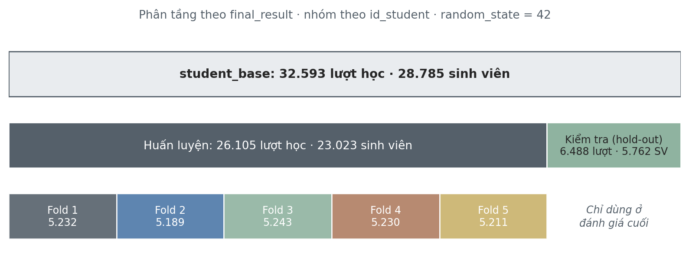

*Hình 1. Sơ đồ phương án chia dữ liệu trên `student_base`.*

#### 4.1.3. Kết quả kiểm tra trên 5 mốc

**Bảng 3.** Quy mô tập huấn luyện và tập kiểm tra theo mốc

| Mốc | Tổng lượt học | Huấn luyện | Kiểm tra | Tỷ lệ kiểm tra | SV huấn luyện | SV kiểm tra |
| --- | ---: | ---: | ---: | ---: | ---: | ---: |
| Tuần 4 | 27.528 | 22.042 | 5.486 | 19,93% | 19.879 | 4.956 |
| Tuần 8 | 26.516 | 21.210 | 5.306 | 20,01% | 19.290 | 4.822 |
| Tuần 12 | 25.722 | 20.572 | 5.150 | 20,02% | 18.800 | 4.705 |
| Tuần 16 | 24.932 | 19.950 | 4.982 | 19,98% | 18.381 | 4.584 |
| Tuần 24 | 23.562 | 18.856 | 4.706 | 19,97% | 17.546 | 4.391 |

Tỷ lệ kiểm tra không đúng tròn 20% vì hai lý do. Thứ nhất, phải đưa trọn một sinh viên (có 1 hoặc nhiều lượt học) vào một phía. Thứ hai, mỗi mốc loại đi những lượt học khác nhau do điều kiện tham gia tại ngày chốt. Mức chênh dưới 0,1 điểm phần trăm là không đáng kể.

**Bảng 4.** Kiểm tra cân bằng và giao thoa

| Mốc | SV chung train–test | SV chung giữa 2 fold | Lệch nhãn train–test lớn nhất | Lệch nhãn fold–train lớn nhất | Lệch học phần–đợt học train–test |
| --- | ---: | ---: | ---: | ---: | ---: |
| Tuần 4 | 0 | 0 | 0,74 điểm % | 1,17 điểm % | 0,58 điểm % |
| Tuần 8 | 0 | 0 | 0,65 | 0,91 | 0,68 |
| Tuần 12 | 0 | 0 | 0,64 | 0,93 | 0,67 |
| Tuần 16 | 0 | 0 | 0,72 | 1,08 | 0,62 |
| Tuần 24 | 0 | 0 | 0,78 | 1,20 | 0,75 |

Không có sinh viên nào thuộc hai tập hay hai fold. Tỷ lệ 4 nhãn giữa các phần lệch dưới 1,3 điểm phần trăm. Phân tầng theo nhóm chỉ đạt gần đúng, vì một sinh viên có thể có nhiều lượt học với nhãn khác nhau. Tỷ trọng học phần–đợt học không được dùng làm tiêu chí phân tầng nhưng vẫn cân bằng (lệch dưới 0,8 điểm %). Một phương án phân tầng kết hợp "mẫu tham gia các mốc" đã được thử, nhưng chỉ giảm độ lệch nhãn khoảng 0,2–0,3 điểm %, nên không được dùng để giữ phương án đơn giản.

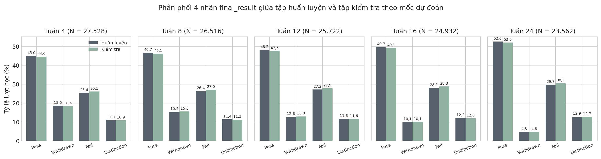

*Hình 2. Phân phối 4 nhãn giữa tập huấn luyện và tập kiểm tra theo mốc.*

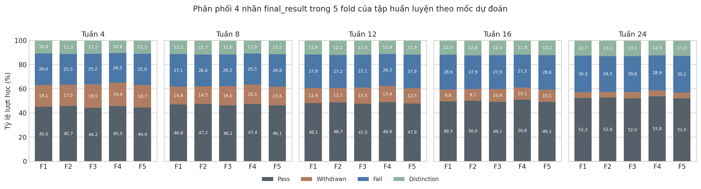

*Hình 3. Phân phối 4 nhãn trong 5 fold của tập huấn luyện.*

Tỷ lệ Withdrawn giảm dần từ 18,6% ở tuần 4 xuống 4,8% ở tuần 24. Nguyên nhân là điều kiện tham gia tại ngày chốt: sinh viên đã rút trước mốc bị loại khỏi tập dữ liệu của mốc đó. Đây không phải do phương án chia. Ở mỗi mốc, nhãn Withdrawn mang nghĩa "sẽ rút sau mốc này".

---

### 4.2. Mã hóa và chuẩn hóa đầu vào

Các phép biến đổi có học tham số đều nằm trong `Pipeline` và được fit lại **trên phần huấn luyện của từng vòng cross-validation**, để tránh thông tin của fold validation lọt vào lúc huấn luyện.

**Bảng 5.** Phương án mã hóa và chuẩn hóa

| Nhóm đặc trưng | Phép biến đổi | Học tham số? | Lý do |
| --- | --- | --- | --- |
| 6 biến phân loại: `gender`, `disability`, `region`, `highest_education`, `age_band`, `imd_band` | One-Hot Encoding với danh mục cố định theo miền giá trị; biến 2 giá trị giữ 1 cột | Không | Gán số thứ tự sẽ tạo quan hệ "lớn hơn" không có thật. Ba biến có thứ tự cũng dùng One-Hot vì số mức ít, không cần giả định khoảng cách giữa các mức bằng nhau, và nhóm `Unknown` của IMD trở thành một cột riêng |
| `late_submission_rate` | Điền trung vị kèm cột cờ thiếu | **Có** (trung vị) | Xem mục 4.2.1 |
| 6 cột click | log1p = log(1 + x) | Không | Phân phối đuôi phải rất dài. Phép biến đổi không loại bỏ giá trị nào, phù hợp quyết định giữ ngoại lai của tuần 3 |
| Các cột số còn lại | Giữ nguyên | Không | Đã là số và không thiếu |

**StandardScaler chưa được áp dụng.** Mô hình tuyến tính cần chuẩn hóa thang đo, còn mô hình cây thì không. Nhóm sẽ dùng cả hai loại, nên việc chuẩn hóa được quyết định cùng việc chọn mô hình. Pipeline đã được thiết kế để thêm bước này mà không phải thay đổi các bước khác.

#### 4.2.1. Xử lý giá trị thiếu của `late_submission_rate`

`late_submission_rate = n_late_submissions / n_submissions_with_due_date`. Khi sinh viên chưa có bài nộp nào có hạn đến ngày chốt, mẫu số bằng 0 nên tỷ lệ không xác định. Tuần 3 cố ý giữ giá trị thiếu, vì hai lý do. Không thay bằng 0, vì "chưa có bài để xét" khác với "không nộp muộn". Không điền trung vị, vì trung vị là tham số học từ dữ liệu, chỉ được ước lượng sau khi chia tập. Phần lớn mô hình của scikit-learn không nhận giá trị thiếu, nên tuần 4 phải xử lý.

**Bảng 6.** Giá trị thiếu của `late_submission_rate` (phần huấn luyện)

| Mốc | Thiếu | Tỷ lệ thiếu | Do chưa nộp bài nào | Tỷ lệ bằng 0 trong số không thiếu | Trung vị (theo vòng CV) |
| --- | ---: | ---: | ---: | ---: | ---: |
| Tuần 4 | 6.448 | 29,25% | 6.246 | 73,91% | 0 |
| Tuần 8 | 3.599 | 16,97% | 3.013 | 66,59% | 0 |
| Tuần 12 | 1.740 | 8,46% | 1.710 | 55,96% | 0 |
| Tuần 16 | 1.575 | 7,89% | 1.541 | 51,91% | 0 |
| Tuần 24 | 1.329 | 7,05% | 1.314 | 44,94% | 0,25 |

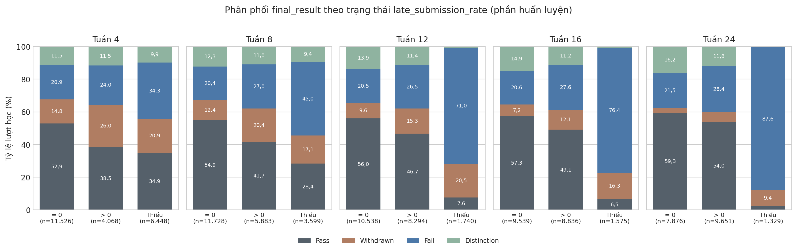

*Hình 4. Phân phối nhãn theo trạng thái `late_submission_rate` (bằng 0, lớn hơn 0, thiếu).*

Nhóm thiếu là **nhóm nguy cơ cao nhất**: tỷ lệ Fail là 34,3% ở tuần 4, 45,0% ở tuần 8 và 87,6% ở tuần 24. Ngược lại, nhóm có tỷ lệ bằng 0 có tỷ lệ Pass cao nhất (52,9–59,3%). Trung vị ở tuần 4–16 bằng 0. Nếu chỉ điền trung vị (hoặc điền 0), nhóm nguy cơ cao nhất sẽ mang cùng giá trị với nhóm tốt nhất. Vì vậy giá trị thiếu được **điền trung vị kèm cột cờ thiếu**. Trung vị chỉ để mô hình nhận được đầu vào dạng số; cột cờ giữ thông tin "chưa có bài để xét". Cách làm này nhất quán với cách tuần 3 xử lý `imd_band` (nhóm `Unknown` kèm cờ `imd_band_missing`).

#### 4.2.2. Biến đổi log1p cho các cột click

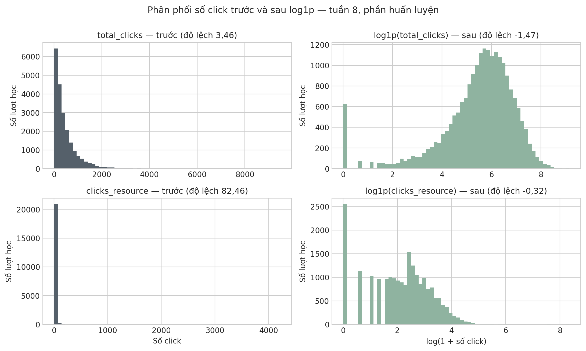

*Hình 5. Phân phối số click trước và sau log1p (tuần 8, phần huấn luyện).*

Ở tuần 8, độ lệch của `clicks_resource` giảm từ 82,46 xuống −0,32, và của `clicks_forumng` từ 7,05 xuống −0,51. Riêng `total_clicks` có độ lệch −1,47 sau biến đổi, do 2,94% lượt học không có click nào tách riêng tại giá trị 0, chứ không phải do mất dữ liệu. log(1 + x) được dùng thay cho log(x) vì cột có giá trị 0. Phép biến đổi giữ nguyên thứ tự giá trị nên không ảnh hưởng đến mô hình cây.

#### 4.2.3. Kiểm tra

Ở cả 25 lần fit (5 mốc × 5 vòng), các kiểm tra đều đạt:
- 23 đặc trưng thành 52 cột số, cùng thứ tự ở mọi vòng và mọi mốc;
- không còn giá trị thiếu;
- trung vị học được đúng bằng trung vị của phần fit, không dùng dữ liệu validation;
- cột cờ khớp đúng vị trí thiếu ban đầu.

---

### 4.3. Khảo sát và lựa chọn đặc trưng

**Bảng 7.** Quy tắc lựa chọn đặc trưng

| Quy tắc | Lựa chọn | Lý do |
| --- | --- | --- |
| Phạm vi | Một danh sách chung cho cả 5 mốc | Mô hình ở các mốc so sánh được với nhau |
| Mức độ loại bỏ | Chỉ loại cột chắc chắn thừa | Chỉ có 23 đặc trưng trên khoảng 20 nghìn lượt học, không cần giảm chiều. Đánh giá độ quan trọng bằng mô hình để ở giai đoạn huấn luyện |
| Tương quan | Loại khi \|Spearman\| ≥ 0,95 **ở cả 5 mốc** | Spearman dựa trên thứ hạng nên phù hợp dữ liệu lệch. Điều kiện "cả 5 mốc" đúng với tinh thần "chắc chắn thừa" |
| Biến ít thông tin | Chỉ ghi nhận; **loại khi gần như độc lập với nhãn ở mọi mốc** (MI < 0,001 và balanced accuracy khi dùng riêng ≈ 0,25) | Ít biến động không có nghĩa là vô ích |

#### 4.3.1. Biến ít thông tin

Mức liên quan với nhãn được đo bằng **thông tin tương hỗ (mutual information, MI)**.

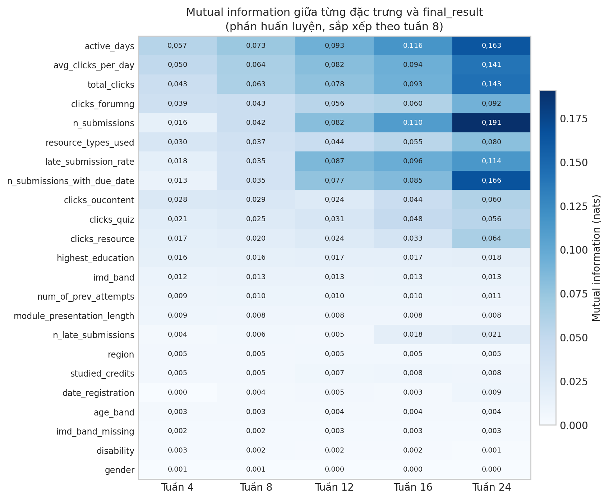

*Hình 6. Mutual information giữa từng đặc trưng và `final_result` theo mốc.*

- **Nhóm VLE và nhóm bài nộp** mang nhiều thông tin nhất, và MI tăng dần theo mốc khi cửa sổ quan sát dài hơn. Ví dụ: `active_days` từ 0,057 lên 0,163; `n_submissions` từ 0,016 lên 0,191.
- **Nhóm thông tin nền** có MI thấp, chỉ từ 0,0003 đến 0,018.
- **`gender`** có MI 0,0003–0,0005 ở cả 5 mốc, dưới ngưỡng 0,001, tức gần như độc lập với nhãn.
- Có 3 mức One-Hot hiếm, dưới 2% lượt học: `No Formal quals`, `Post Graduate Qualification`, `55<=`. Các mức này được ghi nhận và giữ lại.

#### 4.3.2. Tương quan và cột trùng lặp

**Bảng 8.** Các cặp đặc trưng có |Spearman| ≥ 0,8 (phần huấn luyện)

| Cặp đặc trưng | T4 | T8 | T12 | T16 | T24 | Số mốc ≥ 0,95 | Quyết định |
| --- | ---: | ---: | ---: | ---: | ---: | ---: | --- |
| `total_clicks` – `avg_clicks_per_day` | 1,000 | 1,000 | 1,000 | 1,000 | 1,000 | 5 | **Loại** `avg_clicks_per_day` |
| `n_late_submissions` – `late_submission_rate` | 0,993 | 0,973 | 0,963 | 0,933 | 0,913 | 3 | Giữ cả hai |
| `n_submissions_with_due_date` – cờ thiếu | −0,965 | −0,720 | −0,513 | −0,480 | −0,452 | 1 | Giữ cả hai |
| `n_submissions` – `n_submissions_with_due_date` | 0,918 | 0,920 | 0,822 | 0,881 | 0,818 | 0 | Giữ |
| `total_clicks` – `active_days` | 0,872 | 0,895 | 0,900 | 0,902 | 0,909 | 0 | Giữ |

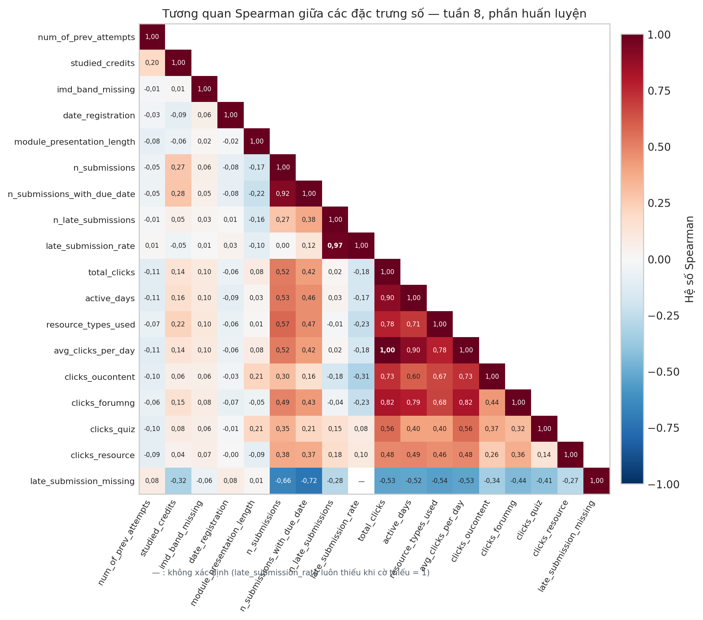

*Hình 7. Ma trận tương quan Spearman giữa các đặc trưng số (tuần 8).*

Sau One-Hot, cột `imd_band_Unknown` **trùng hoàn toàn** với `imd_band_missing` ở cả 5 mốc.

#### 4.3.3. Rà soát nguy cơ rò rỉ

- **Định tính.** Mọi đặc trưng bài nộp và VLE được tính trong cửa sổ [0, t] và đã qua kiểm tra bất biến của tuần 3 (thay đổi dữ liệu sau mốc không làm thay đổi đặc trưng). Nhóm thông tin nền và `module_presentation_length` được chấp nhận theo giả định "có sẵn từ đầu đợt học". OULAD không cung cấp lịch sử cập nhật các thuộc tính này, nên đây là giả định cần lưu ý khi triển khai thực tế.
- **Định lượng.** Với từng đặc trưng đơn lẻ, một cây quyết định độ sâu 3 được đánh giá qua 5 fold. Nếu một đặc trưng đơn lẻ dự đoán gần như hoàn hảo (balanced accuracy ≥ 0,90), đặc trưng đó bị nghi ngờ rò rỉ. Kết quả cao nhất là `n_submissions` với **0,41** ở tuần 24, rất xa ngưỡng 0,90 (mức ngẫu nhiên là 0,25). Không phát hiện dấu hiệu rò rỉ.

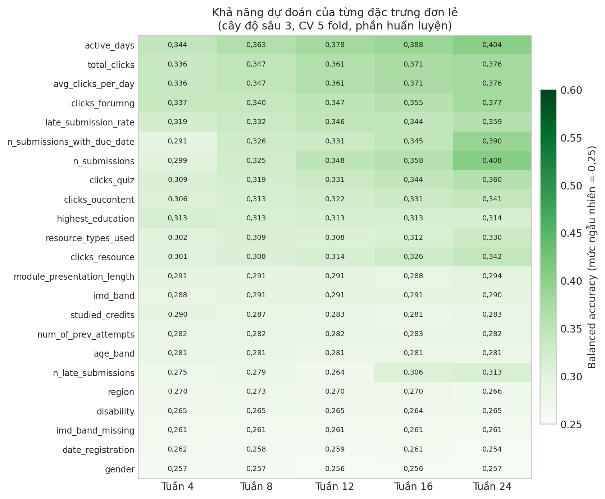

*Hình 8. Balanced accuracy của từng đặc trưng đơn lẻ.*

#### 4.3.4. Kết quả lựa chọn

**Bảng 9.** Các đặc trưng bị loại

| Đặc trưng | Lý do loại |
| --- | --- |
| `avg_clicks_per_day` | Trùng thông tin với `total_clicks`: Spearman bằng 1,000 ở cả 5 mốc, vì `avg_clicks_per_day = total_clicks / (ngày chốt + 1)` với ngày chốt cố định trong mỗi mốc. Giữ `total_clicks` vì đơn giản và dễ diễn giải hơn |
| `imd_band_missing` | Trùng hoàn toàn với cột One-Hot `imd_band_Unknown`. Thông tin thiếu IMD vẫn được giữ qua cột này |
| `gender` | Gần như độc lập với nhãn ở mọi mốc: MI < 0,001, và balanced accuracy khi dùng riêng ≈ 0,256 (ngẫu nhiên là 0,25), nên không mang thông tin dự đoán. Đồng thời `gender` là thuộc tính nhạy cảm; loại bỏ giúp giảm rủi ro hệ thống cảnh báo thiên lệch theo giới tính |

Kết quả: **23 → 20 đặc trưng, 52 → 49 cột sau mã hóa**. Danh sách đầy đủ ở Phụ lục A.

---

### 4.4. Kiểm tra mất cân bằng nhãn và phương án xử lý

#### 4.4.1. Mức mất cân bằng

**Bảng 10.** Phân phối nhãn và chỉ số mất cân bằng (phần huấn luyện)

| Mốc | Pass | Withdrawn | Fail | Distinction | Lớn nhất / nhỏ nhất | Chỉ số |
| --- | ---: | ---: | ---: | ---: | --- | ---: |
| Tuần 4 | 44,95% | 18,65% | 25,40% | 11,01% | Pass / Distinction | 4,08 |
| Tuần 8 | 46,72% | 15,44% | 26,40% | 11,44% | Pass / Distinction | 4,08 |
| Tuần 12 | 48,18% | 12,80% | 27,23% | 11,79% | Pass / Distinction | 4,09 |
| Tuần 16 | 49,68% | 10,07% | 28,09% | 12,16% | Pass / Withdrawn | 4,93 |
| Tuần 24 | 52,57% | 4,85% | 29,71% | 12,87% | Pass / Withdrawn | **10,83** |

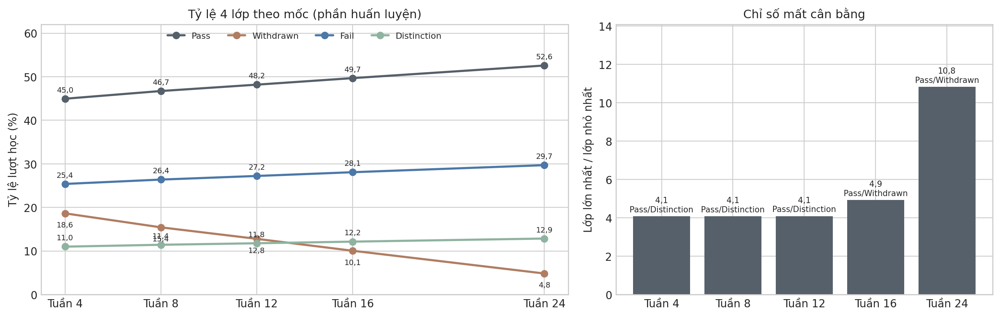

*Hình 9. Tỷ lệ 4 lớp và chỉ số mất cân bằng theo mốc.*

Mức mất cân bằng tăng theo mốc. Từ tuần 16, lớp nhỏ nhất chuyển sang **Withdrawn**, cũng là lớp cần phát hiện sớm nhất. Ở tuần 24 vẫn còn 915 lượt học Withdrawn trong phần huấn luyện, nên mức mất cân bằng chỉ ở mức vừa phải, không cực đoan.

#### 4.4.2. Thước đo đánh giá

Khi dữ liệu mất cân bằng, accuracy có thể cao dù mô hình gần như không dự đoán lớp ít. Ví dụ, luôn đoán Pass ở tuần 24 đạt accuracy 52,57%. Vì vậy:

| Thước đo | Vai trò | Ý nghĩa |
| --- | --- | --- |
| **macro-F1** | Thước đo chính | Trung bình F1 của 4 lớp, mỗi lớp cùng trọng số |
| Balanced accuracy | Bổ sung | Trung bình recall của 4 lớp; mức ngẫu nhiên là 0,25 |
| Recall từng lớp (Fail, Withdrawn) | Bổ sung | Tỷ lệ sinh viên có nguy cơ được phát hiện |
| Accuracy | Chỉ tham khảo | Dễ gây hiểu nhầm khi dữ liệu mất cân bằng |

#### 4.4.3. Ba phương án xử lý

Bước này chỉ **chuẩn bị và kiểm tra** các phương án. Việc so sánh hiệu quả cần mô hình học máy nên được để cho giai đoạn huấn luyện.

**Bảng 11.** Các phương án xử lý mất cân bằng

| Phương án | Cách thực hiện | Ưu điểm | Hạn chế |
| --- | --- | --- | --- |
| Không xử lý | Giữ nguyên phân phối lớp | Làm mốc so sánh; xác suất dự đoán phản ánh tần suất thực | Lớp ít dễ bị bỏ qua |
| Trọng số lớp | `class_weight='balanced'`, w_c = n / (K·n_c), tính lại theo từng vòng. Ở tuần 24, trọng số Withdrawn là 5,15 so với 0,48 của Pass | Không thay đổi dữ liệu, không tạo mẫu giả, nhanh | Mô hình không có tham số `class_weight` phải truyền `sample_weight`; xác suất bị lệch về lớp ít |
| **SMOTENC** | Sinh mẫu cho 3 lớp không phải lớp lớn nhất cho đến khi bằng lớp lớn nhất (k = 5), **chỉ trên phần huấn luyện của từng vòng** | Phương pháp sinh mẫu phù hợp dữ liệu hỗn hợp số–phân loại; phổ biến trong nghiên cứu trên OULAD | Mẫu giả không phải sinh viên thật; xác suất bị lệch; chậm hơn; cần thêm thư viện |

**Vì sao chọn SMOTENC mà không chọn phương pháp sinh mẫu khác.**
- SMOTE gốc, Borderline-SMOTE, SVM-SMOTE, ADASYN và KMeans-SMOTE chỉ dành cho biến số. Nếu áp dụng sau One-Hot, chúng sẽ tạo ra giá trị phân loại vô nghĩa, kiểu "nửa Scotland, nửa Wales".
- Bớt mẫu (undersampling) làm mất dữ liệu thật: ở tuần 24 phải bỏ phần lớn trong khoảng 9.900 mẫu Pass.
- Mô hình sinh (CTGAN, TVAE) quá nặng so với nhu cầu.
- SMOTENC xử lý biến số bằng nội suy và biến phân loại bằng giá trị phổ biến của các láng giềng.

Báo cáo cũng ghi nhận rằng sinh mẫu không phải yếu tố bắt buộc. Với mức mất cân bằng vừa phải, trọng số lớp thường cho hiệu quả tương đương.

**Thứ tự trong pipeline:** điền thiếu và cờ → log1p → **SMOTENC (chỉ khi fit)** → One-Hot → mô hình. SMOTENC không nhận giá trị thiếu nên điền thiếu phải đứng trước. SMOTENC cần biến phân loại ở dạng nhãn gốc nên One-Hot phải đứng sau. Ngoài ra, nội suy số click trên thang log hợp lý hơn với phân phối lệch.

#### 4.4.4. Kiểm tra SMOTENC (không huấn luyện mô hình)

Cả 25 lần sinh mẫu (5 mốc × 5 vòng) đều đạt 5 phép kiểm tra:
1. các dòng gốc được giữ nguyên;
2. sau sinh mẫu, 4 lớp có số lượng bằng nhau;
3. biến phân loại của mẫu giả chỉ nhận giá trị hợp lệ;
4. giá trị số của mẫu giả nằm trong khoảng giá trị của cùng lớp;
5. fold validation không bị sinh mẫu.

Mẫu giả chiếm **44–53%** dữ liệu sau sinh mẫu. Ở tuần 24, lớp Withdrawn tăng từ 732 lên 7.902 lượt học (khoảng 11 lần), tức phần lớn mẫu Withdrawn mà mô hình nhìn thấy là mẫu giả.

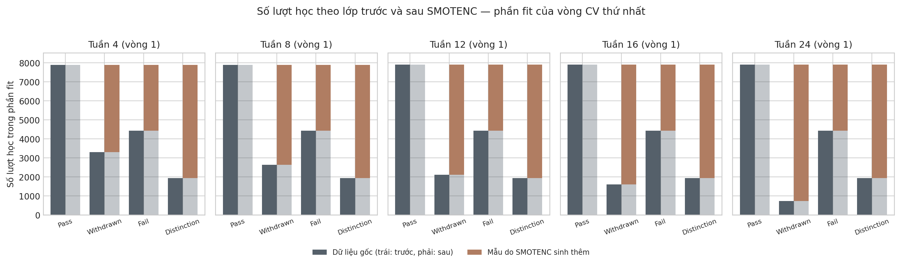

*Hình 10. Số lượt học theo lớp trước và sau SMOTENC (vòng CV thứ nhất).*

**Phát hiện kỹ thuật.** Khi cột ở kiểu số nguyên, thư viện `imbalanced-learn` âm thầm **cắt bỏ phần thập phân** của giá trị nội suy, ví dụ 6,63 bài nộp thành 6 và −30,26 ngày thành −30. Cách cắt này làm giá trị lệch có hệ thống về phía 0. Quy trình đã chuyển các cột số sang số thực trước SMOTENC để giữ đúng giá trị nội suy. Hệ quả là nhiều mẫu giả có giá trị không nguyên ở các cột đếm; ví dụ ở tuần 24, 72,9% mẫu giả có số bài nộp lẻ. Đây là đặc điểm vốn có của SMOTE, được giữ nguyên và cần lưu ý khi diễn giải.

---

### 4.5. Hoàn thiện bộ dữ liệu và pipeline cho mô hình hóa

**Bảng 12.** Các thành phần được đóng gói

| Thành phần | Nơi lưu | Ghi chú |
| --- | --- | --- |
| Tập đặc trưng–nhãn theo mốc | `data/modeling/week{N}_train.csv`, `week{N}_test.csv` | Gồm khóa, mốc, 20 đặc trưng ở **giá trị gốc chưa biến đổi**, và nhãn. Tệp train có thêm cột `fold` |
| Quy trình xử lý | `src/modeling_pipeline.py` | Hằng số; các hàm đọc dữ liệu, chia fold, tiền xử lý; pipeline 3 phương án; hàm đánh giá CV |
| Mô tả và kiểm tra | `data/modeling/modeling_manifest.json`, `README.md` | Phiên bản thư viện, kiểu dữ liệu, số dòng, SHA-256 |

**Các quyết định và lý do:**
- **Lưu dữ liệu chưa biến đổi.** Trung vị điền thiếu và SMOTENC phải được fit lại trong từng vòng cross-validation. Nếu lưu sẵn ma trận đã biến đổi, người dùng sau rất dễ đem đi chia fold và gây rò rỉ.
- **Tách train và test thành hai tệp** để tránh dùng nhầm tập kiểm tra.
- **Code đặt trong một module dùng chung.** Notebook và các thành viên khác chỉ cần `import` là dùng đúng quy trình đã kiểm tra, và chỉ tồn tại một bản code.
- **Không lưu pipeline đã fit** (`.pkl`), vì việc fit thuộc giai đoạn huấn luyện.

**Bảng 13.** Các tệp dữ liệu đã xuất

| Mốc | Train (lượt học / sinh viên) | Test (lượt học / sinh viên) |
| --- | --- | --- |
| Tuần 4 | 22.042 / 19.879 | 5.486 / 4.956 |
| Tuần 8 | 21.210 / 19.290 | 5.306 / 4.822 |
| Tuần 12 | 20.572 / 18.800 | 5.150 / 4.705 |
| Tuần 16 | 19.950 / 18.381 | 4.982 / 4.584 |
| Tuần 24 | 18.856 / 17.546 | 4.706 / 4.391 |

**Kiểm tra:**
- **50 ma trận đầu ra** (5 mốc × 5 vòng × phần fit và validation) đều đạt: 49 cột cùng thứ tự; không có giá trị thiếu hay vô cực; cột One-Hot và cờ chỉ nhận 0/1; cột log không âm.
- **Thử như một người dùng mới:** chỉ đọc `data/modeling/` và dùng module, kết quả trùng hoàn toàn với notebook ở cả 5 mốc.
- **Pipeline của cả 3 phương án** lưu được bằng pickle.

---

### 4.6. Đề xuất thuật toán và mô hình cơ sở

#### 4.6.1. Đề xuất các thuật toán phân loại

Các đặc điểm của bài toán quyết định lựa chọn thuật toán:
- phân loại **4 lớp mất cân bằng**;
- dữ liệu bảng với khoảng 19–22 nghìn lượt học mỗi mốc;
- 49 cột gồm cả One-Hot lẫn biến số lệch, một số đặc trưng tương quan cao;
- cần **diễn giải được** để giảng viên hiểu vì sao sinh viên bị cảnh báo.

Ở bước này các thuật toán **chỉ được đề xuất, chưa huấn luyện**.

**Bảng 14.** Các thuật toán đề xuất

| Thuật toán | Nhóm | Lý do phù hợp | Cần chuẩn hóa | `class_weight` | Ưu tiên |
| --- | --- | --- | --- | --- | --- |
| Logistic Regression (đa lớp) | Tuyến tính | Mô hình cơ sở chuẩn; hệ số diễn giải được; nhanh | Có | Có | **Cao**: mô hình học máy đối chứng đầu tiên |
| Random Forest | Tổ hợp cây (bagging) | Mạnh trên dữ liệu bảng hỗn hợp; chịu được đặc trưng lệch và tương quan | Không | Có | **Cao** |
| HistGradientBoosting | Tổ hợp cây (boosting) | Thường cho kết quả tốt nhất trên dữ liệu bảng; có sẵn trong scikit-learn | Không | Có | **Cao** |
| Decision Tree | Cây | Quy tắc "nếu… thì…" dễ giải thích | Không | Có | Trung bình: chủ yếu để diễn giải |
| XGBoost / LightGBM | Tổ hợp cây (boosting) | Phổ biến trong nghiên cứu trên OULAD; hỗ trợ SHAP | Không | Gián tiếp | Tùy chọn: cần cài thêm thư viện |
| SVM | Biên cực đại | Hiệu quả với dữ liệu nhiều chiều | Có | Có | Thấp: nhân RBF chậm, không trực tiếp cho xác suất |
| K-Nearest Neighbors | Khoảng cách | Đơn giản | Có | Không | Thấp: kém với One-Hot và lớp mất cân bằng |

#### 4.6.2. Mô hình đối chứng DummyClassifier

DummyClassifier **không dùng đặc trưng**, chỉ dự đoán theo một quy tắc cố định. Kết quả của nó là **mức sàn** mà mô hình học máy phải vượt qua mới có ý nghĩa. Hai chiến lược được dùng:
- `most_frequent`: luôn đoán lớp đông nhất (Pass);
- `stratified`: đoán ngẫu nhiên theo tỷ lệ các lớp.

Dummy được chạy qua pipeline đầy đủ bằng cross-validation 5 fold, chỉ trên phần huấn luyện, với phương án "không xử lý" mất cân bằng.

**Bảng 15.** Kết quả DummyClassifier (trung bình 5 vòng)

| Mốc | Chiến lược | Accuracy | macro-F1 | Balanced acc. | Recall Withdrawn | Recall Fail |
| --- | --- | ---: | ---: | ---: | ---: | ---: |
| Tuần 4 | most_frequent | 0,450 | 0,155 | 0,250 | 0 | 0 |
| | stratified | 0,318 | 0,251 | 0,251 | 0,174 | 0,252 |
| Tuần 8 | most_frequent | 0,467 | 0,159 | 0,250 | 0 | 0 |
| | stratified | 0,323 | 0,241 | 0,241 | 0,125 | 0,255 |
| Tuần 12 | most_frequent | 0,482 | 0,163 | 0,250 | 0 | 0 |
| | stratified | 0,341 | 0,249 | 0,249 | 0,121 | 0,262 |
| Tuần 16 | most_frequent | 0,497 | 0,166 | 0,250 | 0 | 0 |
| | stratified | 0,353 | 0,246 | 0,247 | 0,097 | 0,273 |
| Tuần 24 | most_frequent | 0,526 | 0,172 | 0,250 | 0 | 0 |
| | stratified | 0,384 | 0,245 | 0,245 | 0,030 | 0,285 |

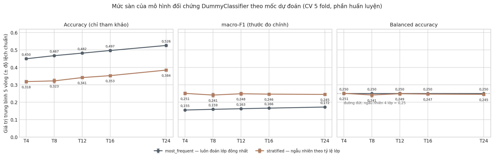

*Hình 11. Mức sàn của DummyClassifier theo mốc dự đoán.*

**Nhận xét:**
- `most_frequent` đạt accuracy tới 52,6% nhưng **không phát hiện được sinh viên có nguy cơ nào**: recall của Withdrawn và Fail bằng 0, macro-F1 chỉ 0,16–0,17. Đây là bằng chứng cụ thể cho việc chọn macro-F1 làm thước đo chính.
- `stratified` đạt macro-F1 và balanced accuracy khoảng 0,25, đúng mức đoán mò.
- **Mức sàn cho các mô hình học máy là macro-F1 ≈ 0,25 và balanced accuracy ≈ 0,25 ở mọi mốc.**

Khung huấn luyện thử (đọc dữ liệu → pipeline → 5 fold → chỉ số theo vòng và ma trận nhầm lẫn) đã chạy ổn định ở cả 5 mốc. Giai đoạn sau chỉ cần thay `DummyClassifier` bằng mô hình thật.

---

## Kết luận tiến độ và kế hoạch tuần tiếp theo

**Kết quả thực hiện.** Dữ liệu năm mốc dự đoán đã sẵn sàng cho mô hình hóa:
- phương án chia theo sinh viên, không giao thoa giữa các tập;
- quy trình mã hóa học tham số trên fold huấn luyện;
- danh sách 20 đặc trưng được chọn có lý do, không có dấu hiệu rò rỉ;
- ba phương án xử lý mất cân bằng đã kiểm tra;
- dữ liệu và code được đóng gói để tái sử dụng;
- mức sàn macro-F1 ≈ 0,25.

**Giới hạn và lưu ý.**
- Thông tin nền được giả định có sẵn từ đầu đợt học, vì OULAD không có lịch sử cập nhật.
- Log VLE trùng hoàn toàn được giữ nguyên theo quyết định của tuần 3, nên các tổng click bao gồm cả các dòng này.
- Mẫu SMOTENC không phải sinh viên thật và có giá trị đếm không nguyên.
- Tập kiểm tra chưa được sử dụng; mọi kết quả hiện tại đều là kết quả cross-validation trên phần huấn luyện.
- Notebook cần thêm thư viện `imbalanced-learn` (0.13.0, tương thích scikit-learn 1.6.1); nhóm cần bổ sung thư viện này vào `requirements.txt`.

### Công việc dự kiến trong tuần 5 *(đề xuất, cần nhóm thống nhất)*

**Bảng 16.** Các hạng mục dự kiến

| STT | Hạng mục | Kết quả cần đạt |
| --- | --- | --- |
| 1 | Huấn luyện các mô hình ưu tiên cao | Logistic Regression (kèm StandardScaler), Random Forest, HistGradientBoosting tại 5 mốc qua 5 fold; so sánh với mức sàn ở Bảng 15 |
| 2 | So sánh 3 phương án mất cân bằng | Đánh giá ảnh hưởng của trọng số lớp và SMOTENC lên macro-F1 và recall của Fail, Withdrawn |
| 3 | Tinh chỉnh siêu tham số | Chỉ dùng cross-validation trên phần huấn luyện; không dùng tập kiểm tra |
| 4 | Phân tích kết quả | Ma trận nhầm lẫn, các lớp dễ nhầm (Fail và Withdrawn), độ quan trọng đặc trưng, diễn biến theo mốc |
| 5 | Chọn mô hình và đánh giá cuối | Chọn mô hình theo kết quả CV, sau đó đánh giá một lần trên tập kiểm tra |

---

## Phụ lục

### Phụ lục A. Danh sách 20 đặc trưng đã chọn

| Nhóm | Đặc trưng | Phép biến đổi | Số cột |
| --- | --- | --- | ---: |
| Thông tin nền | `region`, `highest_education`, `imd_band`, `age_band`, `disability` | One-Hot | 13 + 5 + 11 + 3 + 1 = 33 |
| Thông tin nền | `num_of_prev_attempts`, `studied_credits`, `date_registration`, `module_presentation_length` | Giữ nguyên | 4 |
| Bài nộp | `n_submissions`, `n_submissions_with_due_date`, `n_late_submissions` | Giữ nguyên | 3 |
| Bài nộp | `late_submission_rate` | Điền trung vị + cờ thiếu | 2 |
| VLE | `total_clicks`, `clicks_oucontent`, `clicks_forumng`, `clicks_quiz`, `clicks_resource` | log1p | 5 |
| VLE | `active_days`, `resource_types_used` | Giữ nguyên | 2 |
| **Tổng** | **20 đặc trưng** | | **49 cột** |

### Phụ lục B. Tệp đầu ra của tuần 4

| Loại | Đường dẫn |
| --- | --- |
| Notebook | `modeling_prep.ipynb` |
| Module dùng chung | `src/modeling_pipeline.py` |
| Phương án chia | `data/preprocessed/split_assignment.csv`, `split_manifest.json` |
| Danh sách đặc trưng | `data/preprocessed/selected_features.json` |
| Dữ liệu cho mô hình | `data/modeling/week{4,8,12,16,24}_{train,test}.csv`, `modeling_manifest.json`, `README.md` |
| Bảng số liệu | `report/tables/4_1_*.csv` … `4_6_*.csv` |
| Hình | `report/figures/4_1_*.png` … `4_6_*.png` |

### Tài liệu tham khảo

[1] Kuzilek, J., Hlosta, M., & Zdrahal, Z. (2017). Open University Learning Analytics dataset. *Scientific Data*, 4, 170171. https://doi.org/10.1038/sdata.2017.171

[2] Chawla, N. V., Bowyer, K. W., Hall, L. O., & Kegelmeyer, W. P. (2002). SMOTE: Synthetic Minority Over-sampling Technique. *Journal of Artificial Intelligence Research*, 16, 321–357.
